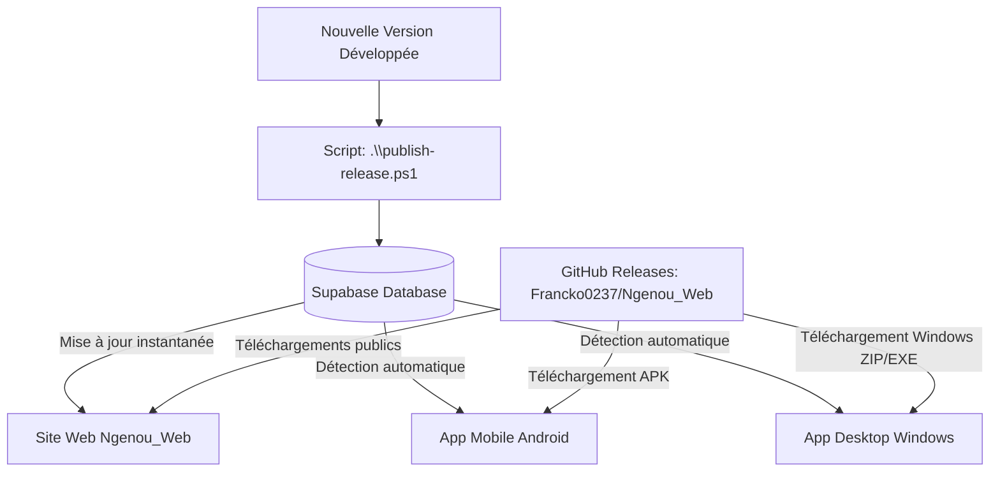

# 🚀 Guide Complet de Déploiement & Mises à Jour Dynamiques Ngenou

Ce guide documente le processus automatisé de publication des nouvelles versions de **Ngenou** pour **Android**, **PC Windows** et le site vitrine **Ngenou_Web**.

---

## 🏛️ Architecture du Système



- **Source de Vérité Dynamique** : Supabase (`app_releases` & `release_features`).
- **Hébergement des Fichiers** : [GitHub Releases Francko0237/Ngenou_Web](https://github.com/Francko0237/Ngenou_Web/releases).
- **Hébergement des Captures d'écran** : GitHub Repo via CDN jsDelivr (`assets/screenshots/`).

---

## 📋 Procédure pour l'IA ou le Développeur

Quand vous dites : **« Déploie la nouvelle version »**, voici le protocole exact exécuté :

### Étape 1 : Préparation des captures (si mise à jour visuelle)
- Déposer les images dans `assets/screenshots/` (ex: `nouvelle_interface.png`, `mode_ia.png`).
- *(Facultatif)* Configurer `assets/screenshots/features.json` pour personnaliser les titres/descriptions.

### Étape 2 : Exécution du script de synchronisation
```powershell
.\publish-release.ps1 -Bump "1.2.0+2" -Title "Mise à jour v1.2.0" -Notes "Nouvelles fonctionnalités et optimisations."
```

Options disponibles :
| Paramètre | Description |
|---|---|
| `-Bump "X.Y.Z+C"` | Incrémente `pubspec.yaml` et synchronise le code Dart |
| `-Title "..."` | Titre affiché sur le site et dans l'app |
| `-Notes "..."` | Changelog détaillé |
| `-Force` | Rend la mise à jour obligatoire (bloque les versions antérieures) |
| `-DryRun` | Simule sans écrire dans Supabase |

---

## 💻 Compilation & Packaging Manuel (Android & Windows)

### 1. Android (APKs 64 bits & 32 bits)
```bash
flutter build apk --split-per-abi
```
Cette commande génère deux APKs optimisés et beaucoup plus légers :
- **64 bits (ARM64)** : `build/app/outputs/flutter-apk/app-arm64-v8a-release.apk`
  ➔ À renommer pour la release : `ngenou-v{versionName}-arm64.apk`
- **32 bits (ARMv7)** : `build/app/outputs/flutter-apk/app-armeabi-v7a-release.apk`
  ➔ À renommer pour la release : `ngenou-v{versionName}-arm32.apk`

*(Si vous préférez un APK universel tout-en-un, lancez `flutter build apk --release` ➔ `ngenou-v{versionName}.apk`)*.

---

### 2. Windows PC (Exécutable / Archive)
```bash
flutter build windows --release
```
- Dossier généré : `build\windows\x64\runner\Release\`
- **Création du ZIP Windows (recommandé en 1 ligne)** :
```powershell
Compress-Archive -Path "build\windows\x64\runner\Release\*" -DestinationPath "build\windows\x64\runner\ngenou-v1.1.1-windows.zip" -Force
```
- *(Optionnel si vous préférez un installateur setup.exe)* : Compilez votre script Inno Setup / NSIS et nommez-le `ngenou-v{versionName}-windows.exe`.

---

## 📦 Téléversement sur GitHub Releases

Dépôt cible : **`Francko0237/Ngenou_Web`**

### Option A : Via GitHub CLI (`gh`)
```bash
gh release create v1.1.1 \
  build/app/outputs/flutter-apk/app-arm64-v8a-release.apk#ngenou-v1.1.1-arm64.apk \
  build/app/outputs/flutter-apk/app-armeabi-v7a-release.apk#ngenou-v1.1.1-arm32.apk \
  build/windows/x64/runner/ngenou-v1.1.1-windows.zip \
  --repo Francko0237/Ngenou_Web \
  --title "Mise à jour Ngenou v1.1.1" \
  --notes "Notes de version..."
```

### Option B : Via l'interface web GitHub
1. Rendez-vous sur : https://github.com/Francko0237/Ngenou_Web/releases/new
2. Tag : `v1.1.1` (ex: `v{versionName}`)
3. Glissez-déposez :
   - `ngenou-v{versionName}.apk`
   - `ngenou-v{versionName}-windows.zip` (ou `.exe`)
4. Cliquez sur **Publish release**.

---

## 🔄 Résultat Immédiat

- **Sur le site web (`Ngenou_Web`)** : La page d'accueil et la section Nouveautés affichent immédiatement la nouvelle version, les captures d'écran et les liens de téléchargement.
- **Sur mobile Android** : Les utilisateurs voient la pop-up proposant de télécharger le nouvel APK.
- **Sur PC Windows** : Les utilisateurs voient la pop-up proposant de télécharger l'archive / installeur Windows.
